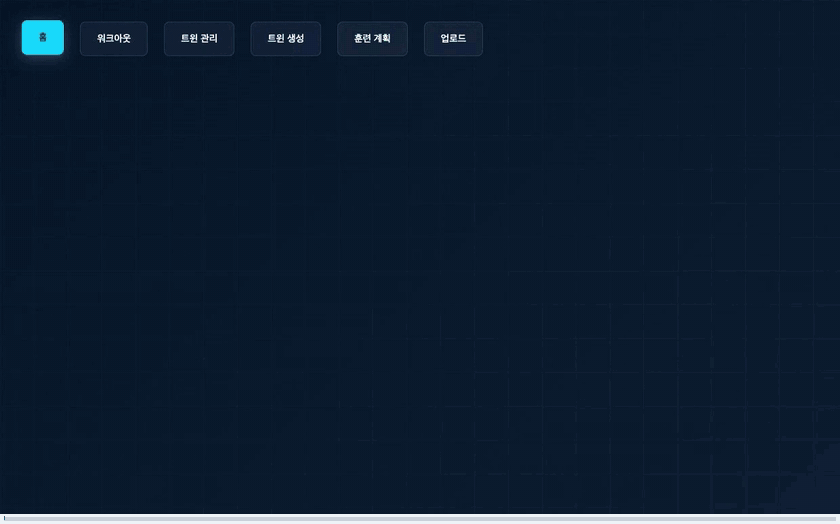
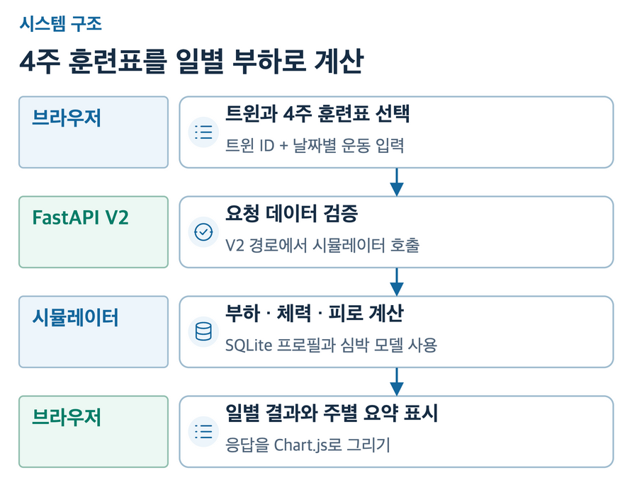
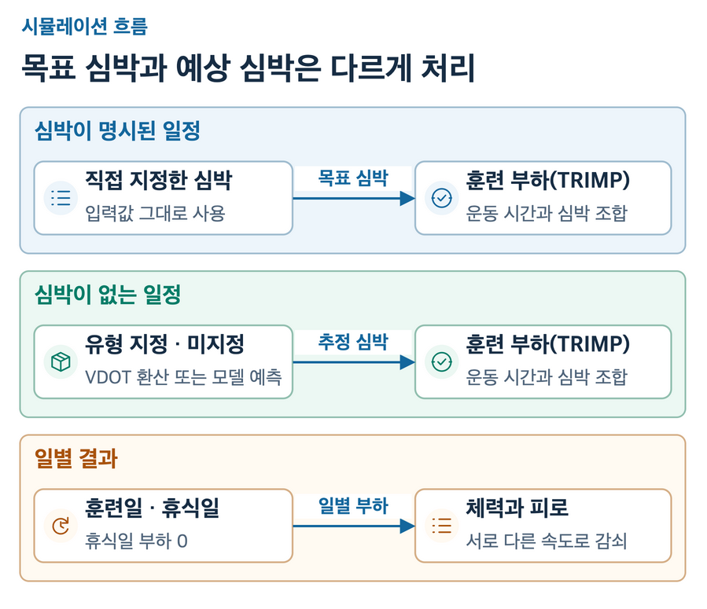
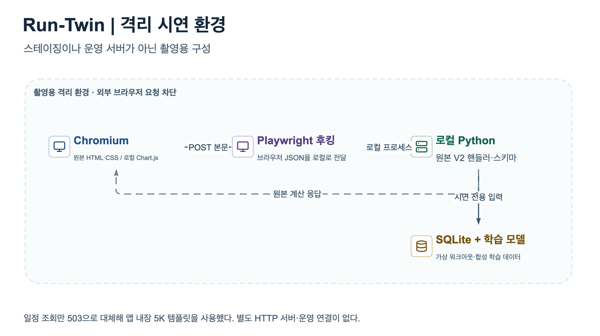

# Run-Twin | 4주 러닝 훈련 시뮬레이터

> 프로젝트 기획과 시뮬레이션 설계, 원본 앱 시연을 수록했습니다.

첫 5K를 준비할 때, 앞으로의 훈련과 휴식이 체력과 피로에 어떤 차이를 만들지 살펴보는 러닝 프로토타입입니다. 운동 강도와 시간을 일별 훈련 부하로 바꾸고, 누적 결과를 주별 수치와 그래프로 보여줍니다. 심박·훈련 부하를 계산하는 모델과 결과 화면을 구현했습니다.

## 5K 목표에서 훈련 결과까지

**5K 목표 선택 → 4주 일정 생성 → 시뮬레이션 실행 → 결과 확인.** 첫 주에는 이지런·인터벌·장거리주 등 4회, 총 23km의 일정이 잡힙니다. 운동별 거리와 페이스 목표를 검토한 다음 시뮬레이션을 실행하면, 주차별 체력(CTL)과 피로(ATL), 두 값의 차이(TSB)를 비교할 수 있습니다.

[첫 주 일정](docs/portfolio-readme/assets/demo-5k-week.png) · [시뮬레이션 결과](docs/portfolio-readme/assets/demo-sim-result.png)

결과 화면에는 러닝 아바타와 VO₂max·CTL이 표시되며, 체력·피로 그래프도 확인할 수 있습니다.

[러닝 아바타와 결과 지표](docs/portfolio-readme/assets/demo-sim-avatar.png)

## 운동 이력과 트윈 프로필

이미 기록한 운동과 앞으로 실행할 계획은 화면을 나눴습니다. 워크아웃 목록에서 달리기 한 건을 열면 거리·시간·페이스·평균 심박과 운동 중 심박 흐름을 볼 수 있습니다. 트윈 관리의 프로필에서는 누적 기록 수, 안정시·최대 심박, VO₂max와 CTL을 확인합니다. 지난 운동의 세부 기록과 다음 4주의 계산을 같은 화면에 섞지 않도록 한 구조입니다.

[워크아웃 상세와 심박 그래프](docs/portfolio-readme/assets/demo-workout-history.png) · [트윈 프로필](docs/portfolio-readme/assets/demo-twin-profile.png)

## 거리 대신 훈련 부하를 계산한 이유

같은 시간 동안 달려도 안정시 심박과 최대 심박 사이에서 어느 강도로 달렸는지에 따라 부하가 다릅니다. 주간 거리만 더하기보다, 트윈의 심박 범위와 운동 시간을 Banister 방식의 TRIMP 계산에 넣었습니다. 예를 들어 안정시 심박 60, 최대 심박 190인 트윈이 30분 달릴 때, 평균 심박을 135에서 160으로 바꾸면 훈련 부하가 **33.53에서 64.68**로 달라집니다.

## 기존 훈련 이력에서 시뮬레이션 시작하기

피로와 체력은 별도로 계산합니다. 같은 훈련 부하를 더하되 서로 다른 감쇠율을 적용하고, 휴식일에는 그날의 부하를 더하지 않습니다. 덕분에 훈련량이 같은 주라도 강한 운동과 휴식을 어떻게 배치했는지에 따른 변화가 그래프에 드러납니다.

초기에는 체력을 0~100 점수로 놓고 피로를 0으로 시작했더니, 기존에 꾸준히 달리던 사람도 새 일정의 첫 훈련에서 피로가 갑자기 치솟았습니다. 그래서 시작점을 훈련 이력에서 잡았습니다. 장기·단기 부하에 각각의 감쇠 기간을 곱해 누적 상태의 초기값을 맞추고, 화면에 돌려줄 때는 다시 평균 부하로 환산합니다. 계획에 아무 운동도 없는 날은 이전 상태가 감쇠할 뿐 두 수치가 0으로 초기화되지 않습니다. 결과 화면에서도 반응 속도가 다른 체력과 피로를 같은 단위로 놓고 비교할 수 있습니다.

## 시스템 구조

브라우저는 트윈 ID와 훈련 계획을 FastAPI V2에 보냅니다. API는 스키마 검증을 거쳐 시뮬레이터에 전달합니다. 시뮬레이터는 트윈의 심박 범위를 읽고 날짜별 부하를 계산해 일별 결과와 주별 요약을 반환합니다. 화면은 응답을 Chart.js로 그립니다.

[편집 가능한 시스템 다이어그램](docs/portfolio-readme/assets/twin-system.drawio)

## 심박에서 체력·피로로 이어지는 계산

1. **목표 심박을 정합니다.** 인터벌처럼 운동 유형에 훈련 존이 있으면 해당 존으로 목표 심박을 정합니다. 존으로 정할 수 없는 운동에는 일반 심박 모델의 예측과 개인 보정값을 사용합니다.
2. **운동별 부하를 계산합니다.** 심박과 운동 시간으로 당일 TRIMP를 구합니다. 휴식일의 추가 부하는 0입니다.
3. **4주 변화를 보여줍니다.** 체력과 피로를 매일 갱신해 주별로 요약합니다. 위 5K 시나리오에서는 28일을 계산했고, 4주차의 체력은 **32.5**, 피로는 **35.4**였습니다.

[편집 가능한 계산 다이어그램](docs/portfolio-readme/assets/twin-workflow.drawio)

### 목표 심박과 예측 심박을 나눈 이유

초기에는 페이스를 모델에 넣어 심박을 예측하고, 그 값으로 다시 부하를 계산했습니다. 하지만 인터벌이나 이지런처럼 **강도가 이미 정해진 계획**에서도 예측 오차가 부하에 그대로 들어가는 문제가 있었습니다. 수행할 계획을 미리 비교하는 경우에는 관측할 심박을 맞히기보다, 계획에서 정한 강도가 계산에 일관되게 들어가는 게 중요했습니다.

그래서 강도가 직접 지정돼 있으면 최대 심박에 해당 비율을 적용하고, 지정값이 없지만 알려진 훈련 유형이면 VDOT 훈련 존의 목표 심박을 사용합니다. 둘 다 없을 때만 페이스·거리·운동 시간·고도·기온 등의 입력으로 일반 모델과 개인 보정을 실행합니다. 위 5K 계획의 이지런·인터벌·장거리주는 훈련 유형으로 목표 심박을 정하는 경로를 탑니다.

## 실행 환경

프로토타입은 HTML·CSS·JavaScript와 Chart.js로 화면을 구성했고, 계산 로직과 데이터 접근은 Python·FastAPI·SQLite로 분리했습니다. 위 시나리오는 내장 5K 일정과 러닝 이력이 들어 있는 로컬 트윈 프로필로 다시 실행할 수 있습니다.

[편집 가능한 실행 환경 다이어그램](docs/portfolio-readme/assets/twin-infrastructure.drawio) · [코드 및 시연 재현 방법](docs/portfolio-readme/docs/evidence.md)
